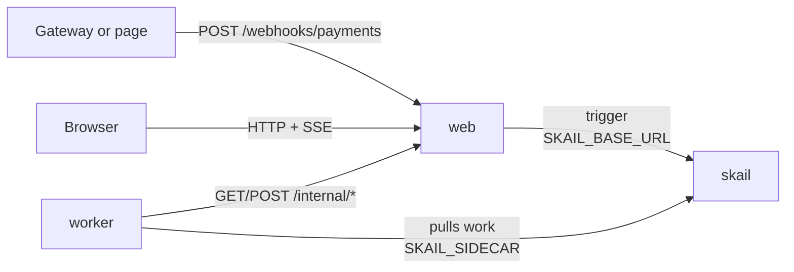

# skail payment webhook (.NET 8)

[Português (Brasil)](README.pt-BR.md)

A payment gateway says a payment came in, sometimes two or three times for the same payment. The web app receives the webhook and starts a skail function with an id derived from the event id, so the resends land on the same run and the order is released once. The order only leaves when the invoice matches; a different amount, a missing invoice or an invoice already paid by another payment goes to finance for review, and the order stays put. A web page plays the gateway and shows each step as it happens.

The demo covers three topics of the [skail docs](https://docs.skail.dev) (in Portuguese):

- the [trigger id](https://docs.skail.dev/referencia/api-http/post-trigger) derived from the business id with UUID v5, so a resend does not start a second run;
- [idempotent commands](https://docs.skail.dev/construa/como-fazer/escrever-commands-idempotentes): each write to the invoices and deliveries uses the event id as the key;
- [handling errors](https://docs.skail.dev/construa/como-fazer/tratar-erros-e-desfazer-passos): a mismatch comes back as a result and goes to finance, while a service that stays down throws.

## How it works



- **worker** (`src/SkailPaymentWebhook.Worker`): the function `ReleaseOrder(payment)` and its commands. `SettleInvoice` checks the invoice and records the payment against it; `ReleaseForDelivery` releases the order; `OpenFinanceReview` sends a mismatch to finance; `ReportStatus` tells the page how the run is going.
- **web** (`src/SkailPaymentWebhook.Web`): the static page, the webhook endpoint, the page API and the demo data (invoices, deliveries and finance reviews), in memory. It starts the run (trigger) and streams the state to the page (SSE).
- **contracts** (`src/SkailPaymentWebhook.Contracts`): types and constants used by the worker and the web app, and the run id from the event id.

In your system, the invoices and deliveries would be in your database. Here they live in the web app, and the worker reaches them over HTTP.

The endpoint turns the event id into the run id with UUID v5 and a fixed namespace of the application. The same event always gives the same id, and skail does not start a second run for an id it already has ([`Program.cs`](src/SkailPaymentWebhook.Web/Program.cs)):

```csharp
var taskId = ExecutionIds.FromEventId(payment.EventId);   // same event => same execution id
await skail.TriggerAsync(taskId, payment, ct);
// If skail did not accept it, answer with an error: the gateway resends later and the resend lands on the same execution.
```

The function only orchestrates and leaves the I/O to the commands. Simplified from [`PaymentFunctions.cs`](src/SkailPaymentWebhook.Worker/PaymentFunctions.cs), which also reports each stage to the page:

```csharp
var settlement = await commands.SettleInvoice(payment);
if (!settlement.Done)
{
    // The money came in, but something does not match: finance reviews it before the order leaves.
    await commands.OpenFinanceReview(payment, settlement.Reason!);
    result = PaymentResults.Pending(settlement.Reason!);
}
else
{
    await commands.ReleaseForDelivery(payment.OrderId, payment.EventId);   // only runs with the invoice settled
    result = PaymentResults.Released;
}
```

A mismatch is a result, not an error, because another attempt would not change it. A web app that does not answer throws, and skail runs the command again (`retryCount: 3`). If every attempt fails, the function reports `Failed` to the page and rethrows, so the run shows up as failed in the Monitor.

## The paths

The page has one button per path. Each button sends a new event to the webhook; **Send again** resends the last one with the same event id. The seeded invoices are **P-1** R$ 99.90 (open), **P-2** R$ 250.00 (open) and **P-3** R$ 80.00 (already paid by `evt_old`).

| Button | What happens | Result |
|---|---|---|
| **P-1 · R$ 99.90** | the invoice is settled and the order is released once | `released for delivery` |
| **Send again** | the same event lands on the same run; P-1 stays released once | (same run) |
| **P-2 · R$ 200.00** | the amount does not match the invoice; finance gets a review | `pending: paid R$ 200.00, invoice R$ 250.00` |
| **P-3 · R$ 80.00** | the invoice was already paid by another payment | `pending: the invoice was already paid by another payment` |
| **P-9 · R$ 10.00** | there is no invoice for the order | `pending: no invoice for order P-9` |

**Reset demo** reopens the invoices and clears the events and reviews.

The page calls the webhook endpoint, which you can also call from a terminal:

```bash
curl -X POST localhost:8080/webhooks/payments -H 'Content-Type: application/json' \
  -d '{"eventId":"evt_1","orderId":"P-1","amount":99.9}'
```

Run it twice: both calls answer the same `taskId`, and P-1 is released once. If skail does not accept the trigger, the webhook answers `502` and the event shows as **Not accepted**; the gateway resends later, and the resend lands on the same run.

## How it connects to skail

| Service | Variable | Used for |
|---|---|---|
| worker | `SKAIL_SIDECAR` | Connects the function to your environment and receives its work. |
| web | `SKAIL_BASE_URL` | Starts runs through the skail HTTP API. |

Both use the same `SKAIL_WORKLOAD`, `SKAIL_NAMESPACE` and `SKAIL_KEY`. The web app makes one call per webhook delivery:

```http
POST {SKAIL_BASE_URL}/api/v1/trigger/{name}/{version}/ReleaseOrder/{taskId}
[{"EventId": "evt_1", "OrderId": "P-1", "Amount": 99.9}]
```

`{name}` and `{version}` come from `SKAIL_WORKLOAD` (`name:version`). The body is the list of the function arguments, with the property names as C# declares them. Each call sends the key in `skail-key` and in `Authorization: Bearer`, plus the `Skail-namespace` header, as described in [authentication](https://docs.skail.dev/referencia/api-http/autenticacao). `429`, `5xx` and network errors are retried with the same task id. `401` and `403` are not retried: check `SKAIL_KEY` and `SKAIL_NAMESPACE`.

The browser never calls skail. It only talks to the web app, so the key stays on the server.

## Requirements

- .NET 8 SDK
- podman or docker
- PowerShell 7+ (`pwsh`), only if you use `scripts/run.ps1` instead of `scripts/run.sh`
- A skail environment with the workload from `SKAIL_WORKLOAD` registered (`demopaymentwebhook:v1.0.0` by default). The [Quickstart](https://docs.skail.dev/comece-aqui/quickstart) shows how to get an account, create the environment and register the workload.
- A current browser (Chrome/Edge 111+, Firefox 113+, Safari 16.2+). The page uses Server-Sent Events, CSS `color-mix()` and modern JavaScript.

## Configure

```bash
cp .env.example .env     # .env holds the key and is ignored by git
```

Fill in `SKAIL_WORKLOAD` (exactly as registered in the portal), `SKAIL_NAMESPACE`, `SKAIL_KEY`, `SKAIL_SIDECAR` and `SKAIL_BASE_URL` with the values of your environment.

## Run with podman or docker

```bash
scripts/run.sh up        # builds both images and starts web + worker
scripts/run.sh logs
scripts/run.sh down
```

`CONTAINER_ENGINE=docker` forces docker. On Windows, or anywhere with PowerShell 7+, run `pwsh scripts/run.ps1 <command>` with the same commands; `$env:CONTAINER_ENGINE = "docker"` forces docker.

Open <http://localhost:8080>. The webhook endpoint is `http://localhost:8080/webhooks/payments`.

### See the resend

1. Press **P-1 · R$ 99.90**. The event goes from **Running** to **Released**, and the P-1 invoice shows `paid by evt_…` and **×1** released.
2. Press **Send again**, once or twice. The **Received** column goes to **×2** or **×3** with the same run id, and P-1 stays at **×1** released.

In the portal, open the [Monitor](https://docs.skail.dev/referencia/portal/monitor) of your environment and search for the run id. There is one run for the event, however many times it was sent. It lists `ReportStatus`, `SettleInvoice`, `ReleaseForDelivery` and `ReportStatus`, each with its arguments and result; on a mismatch, `OpenFinanceReview` takes the place of `ReleaseForDelivery`. Every path ends as **Completed**, because a mismatch is a result; the result of the function says how the payment ended.

`scripts/run.sh kill-worker` kills the worker with SIGKILL, like a crash, and `scripts/run.sh start-worker` starts it again. A run that was in the middle continues from the last finished command, and the order is still released once.

## VS Code

Open the folder and accept the recommended extensions (C# Dev Kit).

- `Ctrl+Shift+B` builds, the *test* task runs the tests and the `containers: up/down/logs/kill-worker/start-worker` tasks call `scripts/run.sh`.
- The **Worker + Web** debug configuration starts both projects reading `.env`, and a breakpoint inside a command works. Outside containers, the worker reaches the web app on `localhost` (`WEB_BASE_URL`, set in `launch.json`).

## Tests

```bash
dotnet test
```

The unit tests cover the contracts and the run id from the event id, the invoice rule (match, wrong amount, missing invoice, already paid, retry of the same settlement), the HTTP calls of the worker, the demo data, the calls to skail (trigger and retries) and the web API with SSE. They need neither network nor skail.

## Notes

- The demo data lives in memory, in the web app. Restarting it loses the paid invoices and the page history, but skail does not run again what it already finished. **Reset demo** starts over.
- The run id comes from the event id, so resending an event from an earlier session lands on the old run. The page creates a new event id on each button press for this reason.
- The signature the gateway sends in a header is not validated here. In production, validate it before the trigger.
- Reading the invoice and recording the payment are two calls. The web app refuses the second one when another event got there first, and the command turns that into a review. A real database would do both in one transaction.
- Amounts are `decimal`, so `99.9` and `99.90` are the same payment.
- The `/internal/*` routes, which the worker calls, have no authentication. That is fine for a local demo; protect them before using the pattern in production.
- Workers with the same `SKAIL_WORKLOAD` on the same environment share the same runs: use one workload (or environment) per person.

## License

[Apache-2.0](LICENSE)
