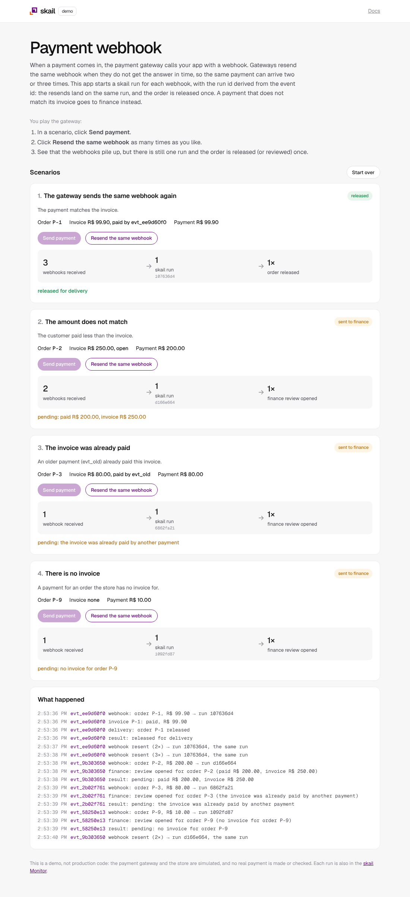

# skail payment webhook (.NET 8)

[English](README.md)

Um app com uma function do skail que libera um pedido quando o gateway de pagamento avisa que o pagamento entrou. Gateways mandam o mesmo webhook duas ou três vezes, então o id da execução sai do id do evento: os reenvios caem na mesma execução, e o pedido é liberado uma vez só. Quando o pagamento não bate com a fatura, o financeiro recebe uma revisão e o pedido fica parado. Você faz o papel do gateway de pagamento numa página que o app serve em http://localhost:8080.

Ele mostra três recursos do skail:

- um **id de execução derivado do id de negócio**: um UUID v5 do id do evento, então um webhook reenviado não inicia uma segunda execução;
- **commands idempotentes**: toda escrita usa o id do evento como chave, então um command repetido não faz a mesma coisa duas vezes;
- **resultados em vez de erros**: um pagamento que não bate volta como resultado e vai para o financeiro, porque outra tentativa não mudaria a resposta.

## Requisitos

- Um destes: [Docker](https://docs.docker.com/get-docker/), [Podman](https://podman.io/docs/installation) ou o [SDK do .NET 8](https://dotnet.microsoft.com/download/dotnet/8.0) (ou mais novo). O script de execução usa o primeiro que encontrar.
- Um environment do skail com um workload registrado para o `SKAIL_WORKLOAD` do `.env` (`demopaymentwebhook:v1.0.0` por padrão). O [Quickstart](https://docs.skail.dev/comece-aqui/quickstart) mostra como criar a conta, o environment e o workload.

O projeto usa o `Skail.Platform.Runtime` **2.3.0-rc.4**.

## Rodar

```bash
cp .env.example .env     # preencha SKAIL_SIDECAR, SKAIL_NAMESPACE e SKAIL_KEY (portal > Environments & keys > Connect)
scripts/run.sh           # depois abra http://localhost:8080
```

No Windows, no PowerShell: `copy .env.example .env` e depois `powershell -ExecutionPolicy Bypass -File scripts\run.ps1`. O script funciona no Windows PowerShell que já vem no Windows; não precisa do PowerShell 7.

O script roda a demo com o que a máquina tiver: Docker, depois Podman, depois o SDK do .NET. Se não achar nenhum, ele diz o que instalar. Sem o script, os comandos são `dotnet run`.



Você faz o papel do gateway de pagamento. A página tem um cartão por cenário: clique em **Send payment** para enviar o webhook dele, com um id de evento novo, e depois em **Resend the same webhook** quantas vezes quiser, como um gateway que não recebeu a resposta a tempo. Cada cartão conta os webhooks recebidos, mostra a única execução do skail em que todos caem e quantas vezes o pedido foi liberado ou uma revisão do financeiro foi aberta: uma vez só, não importa quantos webhooks cheguem. **Start over** volta as faturas ao início. Cada passo também aparece em **What happened** e no console, e a página se atualiza sozinha a cada segundo.

## Os cenários

A loja de demonstração tem três faturas: **P-1** R$ 99,90 (aberta), **P-2** R$ 250,00 (aberta) e **P-3** R$ 80,00 (já paga por um evento antigo).

| Cenário | Pagamento | O que acontece | Resultado |
|---|---|---|---|
| **1. The gateway sends the same webhook again** | P-1, R$ 99,90 | a fatura é paga e o pedido é liberado uma vez, não importa quantas vezes o webhook seja reenviado | `released for delivery` |
| **2. The amount does not match** | P-2, R$ 200,00 | o valor não bate com a fatura; o financeiro recebe uma revisão | `pending: paid R$ 200.00, invoice R$ 250.00` |
| **3. The invoice was already paid** | P-3, R$ 80,00 | a fatura já foi paga por outro pagamento | `pending: the invoice was already paid by another payment` |
| **4. There is no invoice** | P-9, R$ 10,00 | não há fatura para o pedido | `pending: no invoice for order P-9` |

## Como funciona

O app faz três coisas no mesmo processo: serve a página, hospeda o worker que executa a function (`builder.UseSkail()`) e faz o papel do gateway de pagamento e do endpoint do webhook, iniciando uma execução por evento pela API HTTP do skail. A loja de demonstração (faturas, entregas e revisões do financeiro) fica no mesmo processo e registra cada mudança numa linha do tempo que a página mostra.

O id da execução é um UUID v5 do id do evento, com um namespace fixo da aplicação ([`Model.cs`](Model.cs)). O mesmo evento sempre gera o mesmo id, e o skail não inicia uma segunda execução para um id que ele já tem:

```http
POST {SKAIL_SIDECAR}/api/v1/trigger/demopaymentwebhook/v1.0.0/ReleaseOrder/{UUID v5 do id do evento}
[{"EventId": "evt_b64e5476", "OrderId": "P-1", "Amount": 99.90}]
```

A function, em [`PaymentFunctions.cs`](PaymentFunctions.cs):

```csharp
[SkailFunction]
public async SkailTask<string> ReleaseOrder(PaymentConfirmed payment)
{
    var settlement = await SettleInvoice(payment);
    if (!settlement.Done)
    {
        // the money came in, but something does not match: finance reviews it before the order leaves
        await OpenFinanceReview(payment, settlement.Reason!);
        return await ReportResult(payment.EventId, PaymentResults.Pending(settlement.Reason!));
    }

    await ReleaseForDelivery(payment.OrderId, payment.EventId);
    return await ReportResult(payment.EventId, PaymentResults.Released);
}
```

- O `SettleInvoice` confere a fatura e registra o pagamento nela. Uma divergência volta como resultado (`Done = false`), não como exceção.
- O `ReleaseForDelivery` só roda com a fatura quitada, e o `OpenFinanceReview` entra no lugar dele quando há divergência.
- Toda escrita usa o id do evento como chave. Se o app parar no meio de um command, o skail roda o command de novo, e a loja não aplica duas vezes.

| Arquivo | O que tem |
|---|---|
| `PaymentFunctions.cs` | A function e os commands dela. |
| `Model.cs` | O pagamento, os resultados e o id da execução a partir do id do evento (UUID v5). |
| `Demo/SimulatedStore.cs` | A loja de demonstração: faturas, entregas e revisões do financeiro. |
| `Demo/PaymentDesk.cs` | Faz o papel do gateway para a página: envia o pagamento de cada cenário e o reenvia. |
| `Demo/DemoPayments.cs` | O pagamento de cada cenário. |
| `Demo/Timeline.cs` | A linha do tempo dos passos, para o console e a página. |
| `Page/index.html` | A página, com a marca do skail. |
| `Skail/SkailApiClient.cs` | O trigger pela API HTTP do skail. |
| `Program.cs` | Lê o `.env`, serve a página e a API dela, e liga tudo. |
| `scripts/run.sh`, `scripts/run.ps1`, `Dockerfile` | Rodam a demo com Docker, Podman ou o .NET, o que houver na máquina. |

No portal, abra o [Monitor](https://docs.skail.dev/referencia/portal/monitor) do seu environment: há uma execução `ReleaseOrder` por evento, não importa quantas vezes ele foi enviado. Ela lista `SettleInvoice`, `ReleaseForDelivery` e `ReportResult`; quando há divergência, o `OpenFinanceReview` entra no lugar do `ReleaseForDelivery`. Todo caminho termina como **Completed**, porque uma divergência é um resultado.

## Observações

- Cada **Send payment** usa um id de evento novo, então não cai nas execuções de um anterior. A loja de demonstração fica em memória e começa do zero quando o app inicia ou no **Start over**.
- Apps rodando o mesmo `SKAIL_WORKLOAD` no mesmo environment dividem as mesmas execuções: use um workload (ou environment) por pessoa.

## Aviso

**Esta é uma demonstração, não é código de produção.** Ela existe só para mostrar como o [skail](https://docs.skail.dev) funciona e é fornecida "como está", sem garantia de nenhum tipo. O gateway de pagamento e a loja são simulados: nenhum pagamento real é feito ou conferido.

## Licença

[Apache-2.0](LICENSE)
